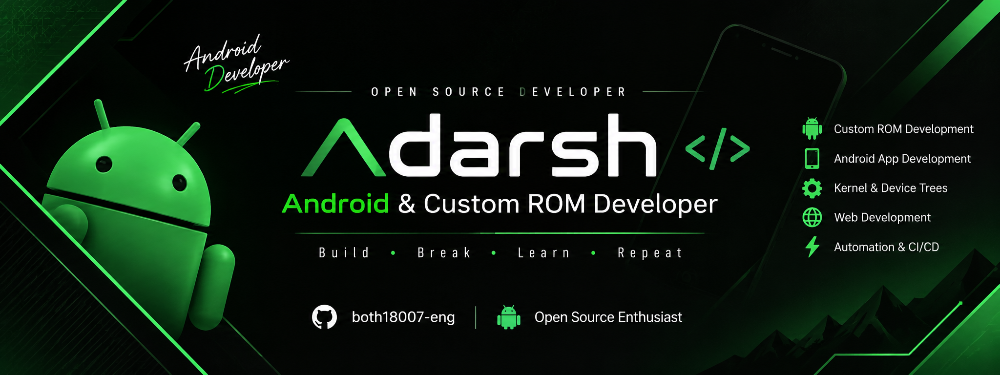

# Hey, I'm Adarsh 👋

### Android & Custom ROM Developer

Building, exploring and experimenting with Android.

---

## 👨‍💻 About Me

- 🔭 Exploring Android development and custom ROMs
- 🤖 Interested in AOSP and Android internals
- 🧪 Testing ROMs and documenting experiments
- 🌐 Building websites and Android applications
- ⚙️ Learning CI/CD and development automation
- 🌱 Always learning and building something new

## 🛠️ Tech & Tools

**Languages**

**Development Tools**

## 🚀 Featured Projects

| Project | Description |
|---|---|
| Android Development Lab | Android research and automation |
| ADx Music | Music player app |
| Developer Portfolio | Personal developer website |

## 🎯 Current Focus

- Android development
- Custom ROM research
- AOSP exploration
- Automation and CI/CD
- Open-source projects

---

### Build • Break • Learn • Repeat

**Thanks for visiting my profile! 💚**

